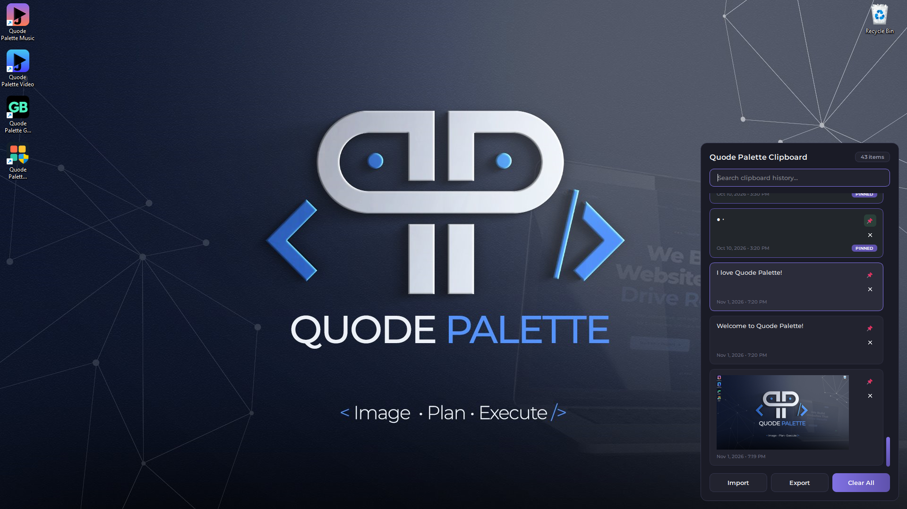

# Quode Palette Clipboard

A fast, lightweight clipboard manager for Windows. It sits in your system tray, keeps your clipboard history, and pastes any item with a single click. 

<p align="center">
  
</p>

## Features

- Open your history from the tray icon or with `Alt+X`
- Click an item to paste it straight into the app you were using
- Pin items you reuse, delete the ones you don't
- Text and image support, including screenshot previews
- Live search across your history
- Export and import your history as a single file, any time
- Starts with Windows (you can turn this off from the tray menu)
- Dark interface, small memory footprint, quick to open

## Getting started

You need Windows and Python 3.10 or newer.

```bat
pip install -r requirements.txt
python main.py
```

The tray icon appears right away. Copy some text or take a screenshot and it shows up in the popup.

## Export and import

You can back up or move your history whenever you like.

- **Export** saves everything (text, images, pin states and timestamps) to one `.json` file.
- **Import** reads a file created by Export and adds its items to your current history. Items you already have are skipped, so importing the same file twice is safe.

Both are available from the Export and Import buttons at the bottom of the popup, and from the tray icon's right-click menu.

## Build an exe

```bat
build.bat
```

This installs the dependencies and compiles the app with Nuitka into one file:

```
dist\Quode Palette Clipboard.exe
```

It is fully self-contained (fonts and icon are inside), so you can copy it anywhere on its own. You need Python 3.10 to 3.12 and a C compiler; Nuitka offers to download one automatically on the first build.

**Startup speed.** A one-file exe has to unpack itself somewhere. This one unpacks only once, into a per-user cache (`%LOCALAPPDATA%\Quode Palette\Quode Palette Clipboard\<build version>`), and reuses it on every later launch. So the very first launch of a new build takes a moment, and every launch after that is near-instant. Deleting that cache folder is always safe; it is rebuilt on the next launch. The app also puts its tray icon up first and finishes loading history right after.

To start it with Windows, leave "Start with Windows" enabled in the tray menu. It is turned on the first time the app runs.

## Project layout

```
main.py                        Entry point and app controller
build.bat                      One-step Windows build (Nuitka, single exe)
version_info.txt               Version details embedded in the exe
app/
  config.py                Colors, fonts, paths and constants
  models.py                ClipboardItem
  storage.py               SQLite history, image files, export and import
  clipboard_monitor.py     Watches the clipboard for changes
  win_paste.py             Paste into the previous window (SendInput and focus handling)
  hotkey.py                Global hotkey registration
  startup.py               Start with Windows
  tray.py                  Tray icon and menu
  single_instance.py       Blocks a second copy from starting
  ui/
    styles.py              Qt stylesheet
    item_widget.py         One history card
    main_window.py         The popup panel
assets/
  icon/icon.ico            Tray and exe icon
  fonts/                   Montserrat font files
docs/screenshot.png        README screenshot
tools/                     Hotkey diagnostic scripts
```

## How it works

| Feature | Notes |
|---|---|
| Single-click paste | The item is copied to the clipboard, focus returns to the window you were in, and Ctrl+V is sent. See `app/win_paste.py`. |
| Images | Screenshots and copied images are saved as PNG files and previewed in the list. |
| Pinned items | Pinned items stay at the top and keep their state across restarts. |
| Clear All | Removes all history except pinned items. |
| Search | Filters as you type. Image items stay visible unless your search is clearly about something else. |
| Single instance | Launching the app twice does not create a second tray icon. |

## Known limitations

- Windows blocks apps from sending keystrokes into windows that run as Administrator. To paste into an elevated app, run Quode Palette Clipboard as Administrator too.
- History and images are stored in `%APPDATA%\Quode\Quode Palette Clipboard\`. If you used an earlier version of this app, your data is moved there automatically on first launch.


## Fonts

The font is under the SIL Open Font License.

## License

Released under the [PolyForm Noncommercial License 1.0.0](LICENSE). You are free to use, modify and share it for personal, educational and other noncommercial purposes. For commercial use, please get in touch.
[Email Us](mailto:hello@quodepalette.com)


